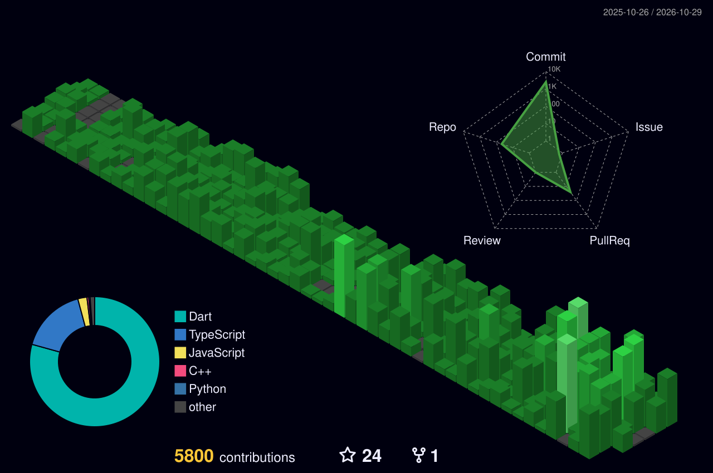

Software Engineer at **[Social Monkey](https://www.socialmonkey.club/)** ([Tribalverse](https://www.tribalverse.in/)) and a fourth-year CSE student specialising in AI/ML.

I like the problems that start out as edge cases and quietly turn into the whole
problem. Most of my time goes into rethinking the flow a user actually takes
through a product rather than the one we assumed, and into writing code that
stays reasonable as it grows.

## Résumé

**[trendysloth1001.github.io/TrendySloth1001](https://trendysloth1001.github.io/TrendySloth1001/)**

The full résumé lives there: experience, projects, a gallery of app screens, skills, and a contribution graph you can explore by year. It also downloads as a one-page PDF.

## Experience

| | Role | Company | When |
| :-- | :-- | :-- | :-- |
|  | **Software Engineer** | [Social Monkey](https://www.socialmonkey.club/) · [Tribalverse](https://www.tribalverse.in/) | Jun 2026 – now |
|  | **Flutter Developer Intern** | SchoolDesk Pro | Jul 2024 – Dec 2024 |

## Projects

- **[Agent Worker](https://github.com/TrendySloth1001/Agent-worker)** (sparky): a personal AI assistant. Flutter app, Express and Postgres backend, multi-model routing, hybrid retrieval with pgvector, long-term memory. [See the screens](https://trendysloth1001.github.io/TrendySloth1001/#gallery)
- **[shopxy](https://github.com/TrendySloth1001/shopxy)**: merchant and customer apps over one Express, Prisma and Postgres API, with POS payments and auditable accounting.
- **[Keepit](https://github.com/TrendySloth1001/keepit)**: an end-to-end encrypted vault. The phone holds every key; the server only ever sees ciphertext.
- **[wordseed](https://github.com/TrendySloth1001/wordseed)** ([live](https://wordseed-five.vercel.app)): sentences grown from one word by an n-gram model and an LSTM, both written from scratch.

## Stack

**Languages**     

**Frameworks**       

**Data** , shopxy, Keepit")    

**Infra**       

## Contact

   

## Activity

<!-- stats:start -->
| Last 12 months | Active days | Public commits | Private work | Pull requests | Longest streak | Busiest day |
| :-- | :-- | :-- | :-- | :-- | :-- | :-- |
| **5,633** contributions | 333 of 369 | 2,455 | 3,105 | 25 | 121 days | 224 on 2 Oct 2026 |

By year: 2026: 5,361 · 2025: 440 · 2024: 99 · 2023: 3. Updated 2026-10-22.
<!-- stats:end -->
