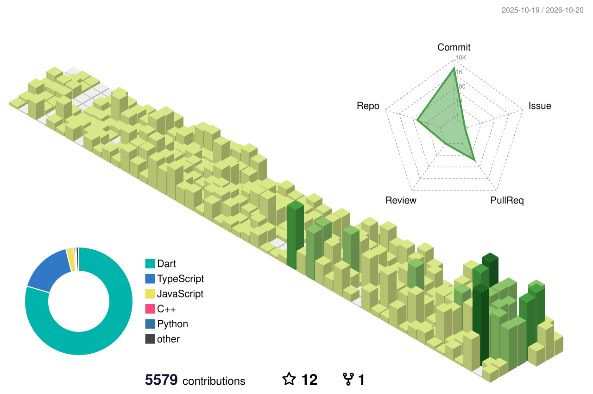

Fourth-year CSE student, specialising in AI/ML.

I like the problems that start out as edge cases and quietly turn into the whole
problem. Most of my time goes into rethinking the flow a user actually takes
through a product rather than the one we assumed, and into writing code that
stays reasonable as it grows.

<a href="mailto:nkumawat8956@gmail.com">nkumawat8956@gmail.com</a> ·
<a href="https://www.linkedin.com/in/nikhil-binwal-78703b32b/">LinkedIn</a> ·
<a href="https://www.instagram.com/nikhilwh0/">Instagram</a> ·
<a href="https://trendysloth1001.github.io/TrendySloth1001/">Résumé site</a>

### Selected work

**[shopxy](https://github.com/TrendySloth1001/shopxy)**: three surfaces over one backend, sketched in the header above.
A merchant app for inventory, invoices, parties and vendors, a customer app for invitations and per-shop
ledgers, and one Express and Prisma API on Postgres. The same JWT shape works across both apps, so one
account works in either. The parts worth the trouble were account linking between merchants and customers,
the POS payment flows, and keeping the accounting auditable. 
Flutter · Express · Prisma · PostgreSQL · Redis · MinIO · Docker

**[Keepit](https://github.com/TrendySloth1001/keepit)**: an end-to-end encrypted vault for passwords, notes,
keys and files. The phone holds every key; the server only ever sees ciphertext. 
Flutter · Express · Prisma · Argon2id · AES-256-GCM

**[wordseed](https://github.com/TrendySloth1001/wordseed)** ([live](https://wordseed-five.vercel.app)): type a
word, get sentences. An n-gram model on a suffix array and a small LSTM, both written from scratch, with every
sentence explained mathematically. 
Next.js · TypeScript · Python · PyTorch

**[MrArgue](https://github.com/TrendySloth1001/argumentbot)**: two local LLMs debate opposite sides of a topic
while a third judges each turn. Streams over SSE, with retrieval for factual context. 
NestJS · Flutter · Ollama

**[Questly](https://github.com/TrendySloth1001/Acehack-questly)** ([live](https://questly.anskservices.com)):
built at AceHack 5.0. Real-world bounties pinned on a map, paid out of Algorand smart-contract escrow once the
poster approves the proof. 
Flutter · Node.js · Algorand

### Technologies

**Languages and frameworks**

<table>
<tr>
<td align="center" width="95"> TypeScript</td>
<td align="center" width="95"> Dart</td>
<td align="center" width="95"> Flutter</td>
<td align="center" width="95"> React</td>
<td align="center" width="95"> Node.js</td>
<td align="center" width="95"><picture><source media="(prefers-color-scheme: dark)" srcset="https://cdn.simpleicons.org/express/FFFFFF" /></picture> Express</td>
<td align="center" width="95"> Python</td>
</tr>
</table>

**Data and queues**

<table>
<tr>
<td align="center" width="95"> PostgreSQL</td>
<td align="center" width="95"><picture><source media="(prefers-color-scheme: dark)" srcset="https://cdn.simpleicons.org/prisma/A9B4C4" /></picture> Prisma</td>
<td align="center" width="95"> Redis</td>
<td align="center" width="95"> BullMQ</td>
<td align="center" width="95"> MinIO</td>
</tr>
</table>

**Infrastructure and hosting**

<table>
<tr>
<td align="center" width="95"> Docker</td>
<td align="center" width="95"> Nginx</td>
<td align="center" width="95"> Coolify</td>
<td align="center" width="95"> Cloudflare</td>
<td align="center" width="95"> SSH</td>
<td align="center" width="95"> Linux</td>
<td align="center" width="95"> Git</td>
</tr>
</table>

Deployed with Coolify, reached over Cloudflare Tunnels and SSH. BullMQ and SSH have no brand mark of their own, so they borrow the Redis and shell glyphs.

### Contributions

<a href="https://trendysloth1001.github.io/TrendySloth1001/">
<picture>
  <source media="(prefers-color-scheme: dark)" srcset="./profile-3d-contrib/profile-night-green.svg" />
  
</picture>
</a>

Click through for the interactive version with daily counts.
